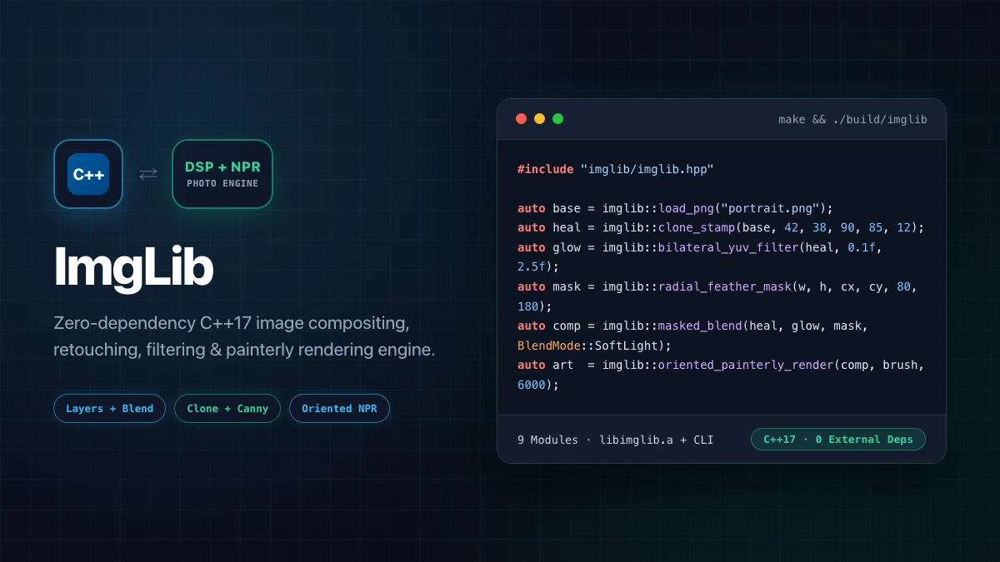

[](https://github.com/mk314k/ImgLib/actions/workflows/c-cpp.yml)


# ImgLib

**ImgLib** is a zero-dependency **C++17 image compositing, retouching, spatial filtering, geometric field morphing, and non-photorealistic rendering (NPR) engine** (`namespace imglib`).



---

## Architecture & Modules

All public headers live under `include/imglib/` (or include everything via `#include "imglib/imglib.hpp"`):

1. **`imglib/canvas.hpp` (`src/canvas.cpp`)**:
   - Interleaved `(x, y, c)` floating-point `Canvas` container normalized to `[0, 1]` with `ZeroPad`, `ClampEdge`, and `Reflect` boundary samplers, element-wise tensor/scalar arithmetic (`+`, `-`, `*`, `/`), and raster drawing primitives (`fill`, `fill_rect`, `stroke_line`).
2. **`imglib/io.hpp` (`src/io.cpp`)**:
   - Lossless PNG decoding/encoding (`load_png`, `save_png` backed by bundled `third_party/lodepng`) and binary P6 PPM I/O (`load_ppm`, `save_ppm`).
3. **`imglib/color.hpp` (`src/color.cpp`)**:
   - Photometric & tone adjustments (`adjust_brightness`, `adjust_contrast`, `adjust_levels`, `equalize_histogram`, `apply_gamma`, `quantize_bits`), luminance-chrominance decomposition (`split_luma_chroma`, `merge_luma_chroma`, `adjust_luma_tone`), `rgb_to_yuv` / `yuv_to_rgb`, `rgb_to_hsl` / `hsl_to_rgb` (`shift_hsl`), `adjust_saturation`, `gray_world_balance`, and `opponent_afterimage_pair`.
4. **`imglib/transform.hpp` (`src/transform.cpp`)**:
   - Multi-kernel image resampling (`resize_nearest`, `resize_bilinear`, Mitchell–Netravali `resize_bicubic`, 3-lobe `resize_lanczos`, unified `resize(src, scale, FilterMode)`), `rotate_center`, `crop_region`, `flip_horizontal`, `flip_vertical`, and `apply_vignette`.
5. **`imglib/filter.hpp` (`src/filter.cpp`)**:
   - 2D spatial convolution (`Kernel2D`), `box_blur`, `gaussian_blur_separable` & `gaussian_blur_2d`, `unsharp_mask`, Sobel edge operators (`sobel_x`, `sobel_y`, `sobel_magnitude`), edge-preserving `bilateral_filter` & `bilateral_yuv_filter`, and morphological `max_pool_filter`.
6. **`imglib/blend.hpp` (`src/blend.cpp`)**:
   - 8 Photoshop layer blend modes (`Normal`, `Multiply`, `Screen`, `Overlay`, `SoftLight`, `HardLight`, `Difference`, `ColorDodge`), multi-layer stack flattener (`flatten_layer_stack`), smoothstep `radial_feather_mask`, and feathered selection compositor (`masked_blend`).
7. **`imglib/retouch.hpp` (`src/retouch.cpp`)**:
   - Feathered patch `clone_stamp` healing tool, `median_filter` for salt-and-pepper impulse noise removal, and `canny_edges` detector (4-sector non-maximum suppression + double-threshold hysteresis).
8. **`imglib/warp.hpp` (`src/warp.cpp`)**:
   - Directed bone coordinate frames (`DirectedBone::to_local`, `to_world`, `point_distance`, `field_weight`), single-bone and multi-bone field warping (`warp_field`), and cross-dissolve sequence morphing (`morph_sequence`).
9. **`imglib/stylize.hpp` (`src/stylize.cpp`)**:
   - Closed-form $2 \times 2$ symmetric structure-tensor eigendecomposition (`solve_symmetric_2x2`, `structure_tensor`, `orientation_field_map`), high-frequency `detail_importance_map`, multi-scale importance-sampled `painterly_render`, and structure-guided `oriented_painterly_render`.

---

## Quickstart

### Build Static Library, CLI & Run Tests

```bash
make          # builds build/libimglib.a and build/imglib CLI
make check    # compiles and runs build/imglib_tests (6/6 test suites)
```

### C++ API Example

```cpp
#include "imglib/imglib.hpp"

int main() {
  auto base = imglib::load_png("input.png");
  auto healed = imglib::clone_stamp(base, 40, 40, 120, 95, 14, 0.7f);
  auto denoised = imglib::bilateral_yuv_filter(healed, 0.1f, 2.0f, 4.0f);
  auto mask = imglib::radial_feather_mask(base.width(), base.height(), 160, 120, 60, 140);
  auto comp = imglib::masked_blend(healed, denoised, mask, imglib::BlendMode::SoftLight);
  imglib::save_png(comp, "output.png");
  return 0;
}
```

### CLI Usage

```bash
./build/imglib gaussian  input.png blurred.png 2.5
./build/imglib bilateral input.png denoised.png 2.0
./build/imglib equalize  input.png equalized.png
./build/imglib hue       input.png shifted.png 30.0
./build/imglib canny     input.png edges.png 1.2
./build/imglib stylize   input.png painted.png 5000
```

## License

Licensed under the [MIT License](LICENSE). Includes [LodePNG](https://lodev.org/lodepng/) (`third_party/lodepng.*`, zlib license).
